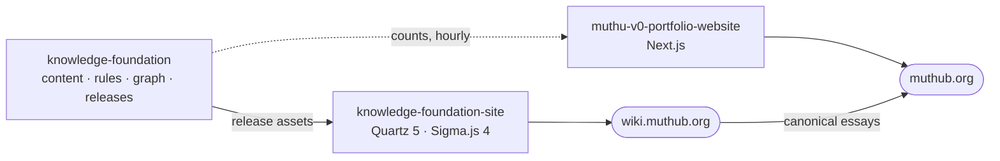

### Muthukrishnan (Muthu) Bommiah

**Distinguished Engineer · Governed enterprise AI · Taking AI from pilot to production in regulated banks, with the controls built in.**

I write essays on governed enterprise AI and keep a working reference system for the argument they make: **AI can write
into a system of record only if every claim carries its source, every change goes through review, and machine output is
kept apart from what a person stood behind.**

| Repository | What it is | Live |
|---|---|---|
| [knowledge-foundation](https://github.com/muthub-ai/knowledge-foundation) | A governed knowledge base: an LLM librarian drafts, a human approves, every claim has a dated source. Open Knowledge Format bundle, a deterministic graph plus a Semantica semantic layer (entity resolution, ontology-typed relations), 16 decision records | [releases](https://github.com/muthub-ai/knowledge-foundation/releases) |
| [knowledge-foundation-site](https://github.com/muthub-ai/knowledge-foundation-site) | The graph you can walk: a Sigma.js WebGL explorer as the home page, Quartz notes with provenance, strict CSP | [wiki.muthub.org](https://wiki.muthub.org) |
| [muthu-v0-portfolio-website](https://github.com/muthub-ai/muthu-v0-portfolio-website) | Essays, initiatives and playbooks, readable by people and agents, with integrity and confidentiality gates in CI | [muthub.org](https://muthub.org) |

**How the work is done:** every change is a pull request with required checks; no bot commits to `main`; decisions are
recorded as ADRs; each repository has a `docs/plan` to rebuild it from scratch.

**Start here:** [Six runs, one canary](https://muthub.org/writing/six-runs-one-canary-governed-extraction) ·
[Architecture that runs](https://muthub.org/writing/architecture-that-runs) ·
[the graph](https://wiki.muthub.org)

Views are my own and do not represent my employer.
